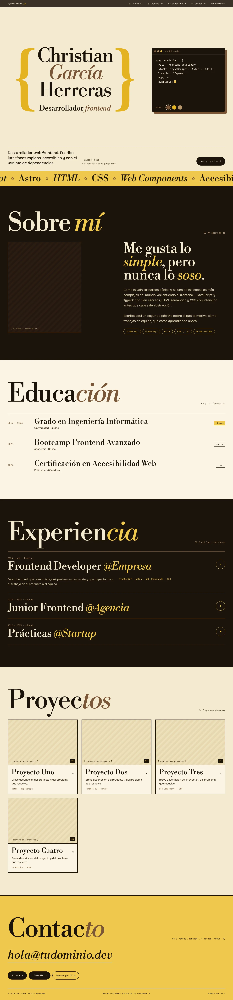
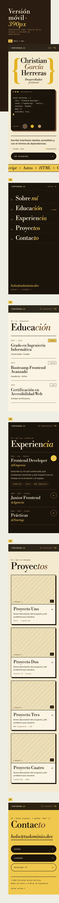

# Design

Visual reference for the portfolio, designed with Claude Design ("Portfolio Vainilla").

- [Desktop (1440px)](#desktop)
- [Mobile (390px)](#mobile)

## Source of truth

These captures are the reference the implementation is built from.
Design tokens (colors, type scale, spacing) are extracted into
[`src/styles/global.css`](../../src/styles/global.css); the code is the
source of truth from then on.

## Typography

| Role               | Family              |
| :----------------- | :------------------ |
| Display / headings | Libre Bodoni        |
| Body               | Bricolage Grotesque |
| Code details       | JetBrains Mono      |

## Desktop

## Mobile

Each artboard shows a key state: hero and nav, open menu, education,
experience accordion, projects and contact.

## Not included

The original Claude Design export is not versioned: it depends on a
proprietary runtime and includes stock images without a redistribution
license.
